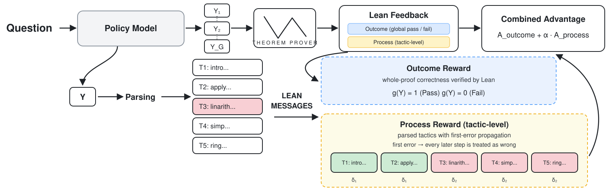

<div align="center">

# Process-Verified Reinforcement Learning for Theorem Proving via Lean

**ICLR 2026**

<p>
  
  
  
  
</p>

</div>

<p align="center">
  
</p>

---

## TL;DR

RL for neural theorem proving normally trains on one bit per proof: *did Lean accept it?* That signal is
sparse, and it is the same for a proof that failed at the first tactic and one that failed at the last.

This repository turns the **Lean compiler itself into a process verifier**. Every rollout is parsed into
its tactics, the Lean message stream is aligned back onto those tactics by source position, and each
tactic receives a label. The resulting dense, token-level **process advantage** is added to the usual
outcome advantage:

```
A(token) = A_outcome  +  α · A_process
```

No learned reward model, no value head, no human annotation — the credit assignment is read directly off
the compiler's diagnostics.

## How the reward is built

**1 · Outcome reward.** The whole proof is compiled. `g(Y) = 1` on a clean `complete` verdict, `0`
otherwise. Group-relative baselining (GRPO group mean, or RLOO leave-one-out) turns it into `A_outcome`.

**2 · Process reward with first-error propagation.** The completion is parsed into tactic spans, Lean's
errors are mapped to character ranges in the same snippet, and spans are labelled by three scalars:

| Case | Label applied |
|---|---|
| Proof passes | every tactic gets `δ0` (`delta0`, default `+1`) |
| Proof fails — tactics *before* the first error | `δ1` (`delta1`, default `-0.05`) |
| Proof fails — the first error and **everything after it** | `δ2` (`delta2`, default `-0.25`) |

The propagation rule is the point: once a tactic fails, the proof state the later tactics were written
against no longer exists, so they are not credited as correct. Set `first_error: false` to fall back to
the flat variant (all tactics `δ1`, only error spans `δ2`) for ablation.

**3 · Combination.** Span labels are converted to returns over the tactic tree (`parse_method: tree`) or
a flat sequence (`advantage`), scattered onto the tokens covered by each span, and mixed with the outcome
term through `alpha_advantage`. The resulting per-token advantages go into a PPO-clipped policy-gradient
loss (`loss_function: grpo | rloo`) with token-level KL to the reference policy.

Everything above lives in [`modules/reward_function.py`](modules/reward_function.py); the trainer that
consumes it is [`modules/new_trainer.py`](modules/new_trainer.py) (`NEWCUSTOMTrainer`).

## Repository layout

```
train.py                        single entry point; TRAINING_TYPE env var picks the trainer
configs/                        one YAML per run (symr*.yaml = this method, grpo/sft/rloo = baselines)
accelerate/                     DeepSpeed ZeRO-3 / FSDP / single-GPU launch configs
modules/
  new_trainer.py                NEWCUSTOMTrainer — vLLM rollout + combined-advantage PPO loss
  reward_function.py            tactic parsing, Lean message alignment, δ labelling, advantage returns
  trainer.py, rloo_trainer*.py  earlier / baseline trainers
  prover/lean/verifier.py       Lean 4 REPL client + Lean4ServerScheduler (parallel compilation)
  bfs.py, mtcs.py               search-based proving utilities
eval/                           3-step evaluation: generate → compile → summarize
data/                           miniF2F, ProofNet, Lean Workbook, STP splits (jsonl)
utils/configs.py                all config dataclasses (every knob below is defined here)
```

## Installation

### Python environment

```bash
pip install uv
uv pip install -r requirements2.txt
pip install flash-attn==2.6.3 --no-build-isolation
```

### Lean 4 + Mathlib + REPL

The verifier shells out to a real `lake exe repl`, so a working Mathlib build is required.

```bash
# 1. toolchain
curl https://raw.githubusercontent.com/leanprover/elan/master/elan-init.sh -sSf | sh
export PATH="$HOME/.elan/bin:$PATH"
elan toolchain install leanprover/lean4:4.9.0-rc1
elan default leanprover/lean4:4.9.0-rc1

# 2. Mathlib pinned to the commit this project was developed against
git clone https://github.com/xinhjBrant/mathlib4.git
cd mathlib4
git fetch origin 2f65ba7f1a9144b20c8e7358513548e317d26de1
git checkout 2f65ba7f1a9144b20c8e7358513548e317d26de1
```

Make sure `lakefile.lean` pins exactly these dependencies — the REPL tactic extraction depends on them:

```lean
require batteries from git "https://github.com/leanprover-community/batteries" @ "42b5dddbd6b2658fcfede9dad26cc47737edec2d"
require Qq from git "https://github.com/leanprover-community/quote4" @ "a7bfa63f5dddbcab2d4e0569c4cac74b2585e2c6"
require aesop from git "https://github.com/leanprover-community/aesop" @ "7e3bd939c6badfcb1e607c0fddb509548baafd05"
require proofwidgets from git "https://github.com/leanprover-community/ProofWidgets4" @ "v0.0.36"
require Cli from git "https://github.com/leanprover/lean4-cli" @ "2cf1030dc2ae6b3632c84a09350b675ef3e347d0"
require importGraph from git "https://github.com/leanprover-community/import-graph.git" @ "7983e959f8f4a79313215720de3ef1eca2d6d474"
require REPL from git "https://github.com/xinhjBrant/repl.git" @ "master"
```

Then build (this takes a while on a cold cache):

```bash
lake update
lake build
lake update REPL
```

### Point the verifier at your Mathlib

> [!IMPORTANT]
> [`modules/prover/lean/verifier.py`](modules/prover/lean/verifier.py) hardcodes the workspace path.
> Edit it before the first run, or nothing will compile:
>
> ```python
> DEFAULT_LAKE_PATH      = f'{HOME_DIR}/.elan/bin/lake'
> DEFAULT_LEAN_WORKSPACE = '/path/to/your/mathlib4'   # <-- change this
> ```
>
> The training data paths in [`train.py`](train.py) (around line 196) are hardcoded in the same way —
> point them at the jsonl files under [`data/`](data/).

## Data

| File | Use |
|---|---|
| `data/training_dataset_random_15419.jsonl` | RL training statements (Lean Workbook sample) |
| `data/train_dataset/deepseek_rl_random_15429.jsonl` | RL training statements, DeepSeek-Prover prompt format |
| `data/lean_workbook_split.jsonl` | full Lean Workbook split |
| `data/miniF2F_test.jsonl`, `data/miniF2F_valid.jsonl` | miniF2F evaluation |
| `data/proofnet_test.jsonl` | ProofNet evaluation |
| `data/workbook_test_200.jsonl` | held-out Lean Workbook probe |
| `data/toy_train.jsonl`, `data/toy.jsonl` | tiny splits for smoke tests |

`dataset_name` in the config selects the path by substring (`workbook`, `deepseek`, `mix`, `stp`,
`minif2f`).

## Training

`TRAINING_TYPE` chooses the trainer, the YAML chooses everything else.

| Script | `TRAINING_TYPE` | Config | What it runs |
|---|---|---|---|
| `train.sh` | `CUSTOM` | `configs/symr.yaml` | **this method** — full-parameter / LoRA, ZeRO-3 |
| `train_peft.sh` | `CUSTOM` | `configs/symr_peft.yaml` | this method, LoRA only |
| `train_baseline.sh` | `GRPO` | `configs/grpo.yaml` | outcome-only GRPO baseline |
| `train_sft.sh` | `SFT` | `configs/sft.yaml` | SFT warm start |

```bash
bash train.sh          # or: bash train_peft.sh / train_baseline.sh / train_sft.sh
```

Each script is just an `accelerate launch` with an `accelerate/*.yaml` backend; swap
`deepspeed3.yaml` for `sft.yaml` / `fsdp.yaml` / `debug.yaml` as needed. `train.py` installs a
`SIGUSR1` / `SIGTERM` handler that checkpoints before exiting, and `train_peft.sh` /
`train_baseline.sh` carry the matching `#SBATCH --signal=B:SIGUSR1@300`, so a Slurm preemption saves
instead of dying.

### Key knobs

All of these live in `configs/symr.yaml` (defined in [`utils/configs.py`](utils/configs.py)):

| Field | Default | Meaning |
|---|---|---|
| `alpha_advantage` | `1` | weight α on the process advantage |
| `weighted_adv` | `false` | `true` → convex mix `α·A_proc + (1−α)·A_out` instead of adding |
| `delta0 / delta1 / delta2` | `1 / -0.05 / -0.25` | tactic labels: pass / pre-error / post-error |
| `first_error` | `true` | propagate the first error to all later tactics |
| `adv_baseline` | `group` | `group` (GRPO mean) or RLOO leave-one-out |
| `score_assign` | `start` | which tokens of a tactic carry its advantage: `start`, `last`, `all`, `mix` |
| `adv_method` | `label` | use raw span labels, or discounted `return`s over the tactic tree |
| `parse_method` | `tree` | tactic tree vs. flat interval list |
| `loss_function` | `grpo` | PPO-clipped surrogate; `rloo` also available |
| `num_generations` | `4` | rollouts per statement (group size) |
| `potent_func` | `false` | optional potential-based shaping (`potent_type`, `potent_coef`) |
| `asymmetric` | `false` | process shaping on failures only, outcome-only on successes |
| `entropy_adv` / `entropy_reg` | `false` | entropy-aware advantage / regularization |
| `tactic_distribution` | `false` | redistribute a tactic's advantage across its tokens (`distribution_method`) |
| `negative_dropout` | `false` | drop a fraction of failed rollouts (`dropout_rate`) |

Rollouts are generated with vLLM in-process (`use_vllm: true`,
`vllm_gpu_memory_utilization`, `max_completion_length`), and compiled in parallel by
`Lean4ServerScheduler`.

## Evaluation

Three stages: sample proofs → compile them in Lean → aggregate pass@N.

```bash
cd eval

# full model
bash inference.sh -i ../data/miniF2F_test.jsonl \
                  -m <hf_model_or_path> \
                  -o ./results/minif2f/<run_name> \
                  -s test -n 32 -c 32 -g 1

# LoRA adapter (set PEFT_PATH inside the script)
bash peft_inference.sh -i ../data/miniF2F_test.jsonl -m <base_model> -o ./results/... -n 32
```

`-n` is the sampling budget (pass@N), `-c` the number of parallel Lean workers, `-g` the tensor-parallel
size. The script chains:

1. `step1_inference.py` — vLLM sampling → `to_inference_codes.json`
2. `step2_compile.py` — `Lean4ServerScheduler` → `code_compilation.json`
3. `step3_summarize_compile.py` — → `compilation_summarize.json` (+ a per-theorem `.csv`)

A theorem counts as solved if **any** of its N samples compiles with `complete: true`, i.e. pass@N.
Use `inference_step2.sh` to re-run only compilation + summary on existing samples.

## Notes & troubleshooting

**Older TRL versions** clip symmetrically. For the asymmetric (DAPO-style) upper bound used here, patch
the surrogate as:

```python
epsilon_high = self.epsilon + 0.08
coef_1 = torch.exp(per_token_logps - old_per_token_logps)
coef_2 = torch.clamp(coef_1, 1 - self.epsilon, 1 + epsilon_high)
is_clipped = ((coef_1 < 1 - self.epsilon) & (advantages.unsqueeze(1) < 0)) | \
             ((coef_1 > 1 + epsilon_high) & (advantages.unsqueeze(1) > 0))
```

**Stale REPL processes.** `Lean4ServerScheduler` reaps `repl` processes older than its timeout, but after
a hard crash it is worth running `killall repl` before relaunching.

**GPU memory.** vLLM and the trainer share the device. Lower `vllm_gpu_memory_utilization` (0.5 is the
default here, 0.65 for the larger DeepSeek models) before touching the batch size.

## Acknowledgements

The Lean verifier and prompt utilities are adapted from
[DeepSeek-Prover-V1.5](https://github.com/deepseek-ai/DeepSeek-Prover-V1.5), the evaluation pipeline from
[Goedel-Prover](https://github.com/Goedel-LM/Goedel-Prover), and the REPL from
[xinhjBrant/repl](https://github.com/xinhjBrant/repl). Training data draws on
[Lean Workbook](https://github.com/InternLM/InternLM-Math) and
[STP](https://github.com/kfdong/STP). Thanks to all of them.

## Citation

```bibtex
@inproceedings{kim2026processverified,
  title     = {Process-Verified Reinforcement Learning for Theorem Proving via Lean},
  author    = {Kim, Minsu},
  booktitle = {International Conference on Learning Representations (ICLR)},
  year      = {2026}
}
```
